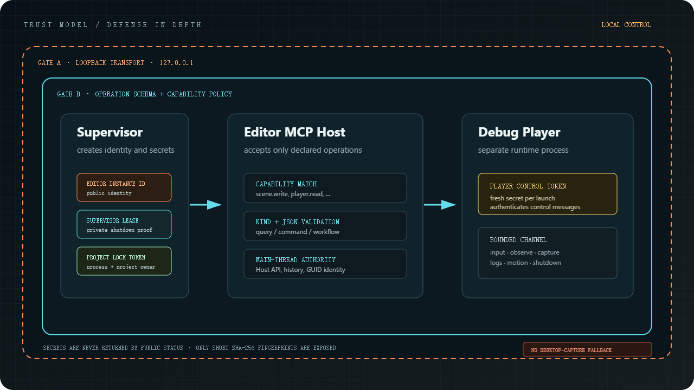

# Notes

This is a local development hook, not a public server. It only binds to localhost.

Every call is checked against the operation schema and `ProjectSettings/mcp_capabilities.json`. Read the schema's `reversible` and `side_effects` fields before editing. Commands that declare undo support use the Editor's normal undo stack; saving or reloading files, checkpoint restoration and Player builds are not general undo transactions.

Screenshots come from the engine's Scene, Game, or composed Editor render targets, never from the desktop.

A few short-lived tokens exist for shutting down the Editor, locking the current project, and talking to a Debug Player. Status calls never return the secret itself.
The HTTP endpoint has no authentication: MCP access is directed by the local user, and every capability is granted by default. To restrict an agent, narrow `granted_capabilities` (for example `["*.read"]`). Requests whose Host is not `127.0.0.1`/`localhost`, or whose browser Origin is not a local page, are rejected so a remote web page cannot reach the port through DNS rebinding.

Development access is trusted access, not a sandbox. Writing project Python or building a Player can execute code with the Editor user's privileges.
